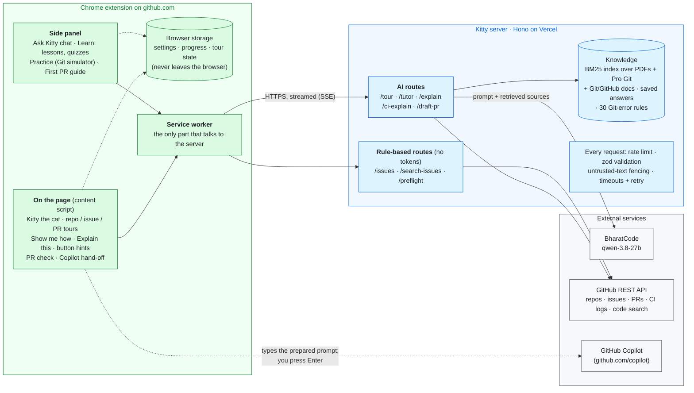

# Kitty

Kitty is a Chrome extension (Manifest V3) plus a small Hono server. The extension adds a pixel cat to github.com; the server fetches context from GitHub, retrieves matching learning material, and calls BharatCode's `qwen-3.8-27b` model.

## Features

| Feature | Where | Model calls |
|---|---|---|
| Repo tour | Cat menu on a repo page. Picks 5–12 files (README, build files, entry point, core modules, tests, CI) and explains each one. | Yes |
| Issue walkthrough | Cat menu on an issue page. Files likely involved, plus git commands for your fork and branch. | Yes |
| PR tour | Cat menu on a PR. Walks through the changed files and their diffs. | Yes |
| Ask Kitty | Side panel chat. Cited answers; can read the open page and the repo's files; adapts to your level. | Yes, except saved answers and recognised Git errors |
| Explain this | Select text on GitHub, or right-click. Commands get a risk label. | Yes |
| Why did this fail? | Cat menu on a failed Actions run. | Yes, unless only an exit code is available |
| Good first issues | Cat menu on a repo, or "find me an issue about X" in the chat. | No |
| Check my PR | Cat menu on a PR: conflicts, description, linked issue, tests, commit hygiene, secrets and debug code in the diff. Optional drafted description. | Only for the draft |
| Learn tab | Lessons, spaced-review quizzes, a Git simulator for practice, and a first-PR checklist. | No |
| Show me how | Cat menu. Step-by-step pointers to GitHub's own buttons and tabs. | No |
| Button hints | Hover buttons like *Sync fork* or *Squash and merge*. | No |
| Copilot hand-off | Requests to write code are typed into GitHub Copilot's chat for you to review and send. | No |

## Install

1. Download the zip from the [latest release](https://github.com/Krish6115/GitKitty/releases/latest) and unzip it.
2. Open `chrome://extensions`, turn on Developer mode, click **Load unpacked** and pick the folder.
3. Open a repository on github.com and click the cat.

Release builds use the hosted server at `https://kitty-server.vercel.app` (20 requests per minute per IP). You can add your own BharatCode key in Settings.

## How it works



The cat and the side panel send requests through the service worker, which is the only part that talks to the server. The server pulls what it needs from GitHub (files, issues, diffs, CI logs), finds the most relevant chunks in a prebuilt BM25 index, and streams the model's answer back over SSE.

- **Grounding:** the PDFs and `*/references/` are chunked into `server/data/index.json` at build time. There's no embeddings endpoint, so retrieval is lexical. The tutor has to cite the chunks it uses.
- **Untrusted input:** repository and page text is fenced off in the prompt, so a README that tries to instruct the model is treated as data.
- **Slow or busy model:** 503s are retried after 2, 4 and 8 seconds. The chat gives up after 45 seconds and falls back to the closest saved answer. Tours fall back to Kitty's own notes for each file.
- **Keys:** the BharatCode key lives on the server. Users can bring their own key, which is sent as `X-Kitty-Key`.
- **GitHub token:** optional. With `GITHUB_TOKEN` set (a classic token with the `public_repo` scope), the server gets higher rate limits, code search, and full CI logs. Without it, CI explanations only see GitHub's summary.

## Local development

```bash
cd kitty
npm ci
cp server/.env.example server/.env   # set LLM_PROVIDER=bharatcode and BHARATCODE_API_KEY to use the real model
npm run dev -w server                # http://localhost:8787, mock model by default
npm run build:e2e -w extension       # extension build that talks to localhost
```

Load `kitty/extension/dist` as an unpacked extension. A plain `npm run build` points at the hosted server instead.

| Command | |
|---|---|
| `npm test` | Unit tests for server, extension and ingest (network disabled) |
| `npm run eval -w ingest` | Retrieval check: 62 questions, hit@6 must stay at or above 85% |
| `npm run ingest` | Rebuild the knowledge index from the PDFs and references |
| `npm run build-faq -w server` | Regenerate the saved answers in `server/data/faq.json` with the real model |
| `npm run e2e -w extension -- all` | Browser tests, see [extension/e2e/README.md](extension/e2e/README.md) |
| `npm run package -w extension` | Build the release zip |

## Self-hosting on Vercel

- Root directory: `kitty/server`
- Framework preset: Hono
- Install command: `cd .. && npm ci -w server --include-workspace-root`
- Environment: `LLM_PROVIDER=bharatcode`, `BHARATCODE_API_KEY`, optionally `GITHUB_TOKEN` and `RATE_LIMIT_PER_MIN`

Then point Kitty at it under Settings → Advanced.

## Cost

Measured on the live model:

| Request | Tokens | Time |
|---|---|---|
| Repo tour | ~10k | first step in ~2 s, all explanations in 20–90 s |
| Chat answer | 3–5k | first words in 3–8 s |
| Saved answer or recognised Git error | 0 | instant |
| Explain this | ~1k | 5–14 s |

Tours are cached per commit, so touring the same repo again is free.

## Credits

Kitty's knowledge comes from this repo's PDFs and adapted excerpts from [Pro Git](https://git-scm.com/book) by Scott Chacon and Ben Straub ([CC BY-NC-SA 3.0](https://creativecommons.org/licenses/by-nc-sa/3.0/)), [GitHub Docs](https://github.com/github/docs) ([CC BY 4.0](https://creativecommons.org/licenses/by/4.0/)) and the [Git documentation](https://git-scm.com/docs) ([GPL-2.0](https://github.com/git/git/blob/master/COPYING)). Each excerpt is attributed in [`Git/references/SOURCES.md`](../Git/references/SOURCES.md). UI icons are [Octicons](https://github.com/primer/octicons) (MIT, GitHub Inc.).
